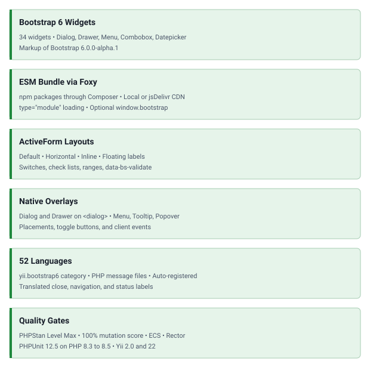

<!-- markdownlint-disable MD041 -->
<p align="center">
    <picture>
        <source media="(prefers-color-scheme: dark)" srcset="https://www.yiiframework.com/image/design/logo/yii3_full_for_dark.svg">
        <source media="(prefers-color-scheme: light)" srcset="https://www.yiiframework.com/image/design/logo/yii3_full_for_light.svg">
        
    </picture>
    <h1 align="center">Bootstrap 6</h1>
    <br>
</p>
<!-- markdownlint-enable MD041 -->

<p align="center">
    <a href="https://github.com/yii2-extensions/bootstrap6/actions/workflows/build.yml" target="_blank">
        
    </a>
    <a href="https://dashboard.stryker-mutator.io/reports/github.com/yii2-extensions/bootstrap6/main" target="_blank">
        
    </a>
    <a href="https://github.com/yii2-extensions/bootstrap6/actions/workflows/static.yml" target="_blank">
        
    </a>
    <a href="https://github.com/yii2-extensions/bootstrap6/actions/workflows/security.yml" target="_blank">
        
    </a>
</p>

<p align="center">
    <strong>Bootstrap 6 widgets, forms, and asset bundles for Yii2</strong><br>
    <em>ESM-only Bootstrap bundle installed through Foxy, plugins loaded without a global</em>
</p>

> [!IMPORTANT]
> This package pins Bootstrap `6.0.0-alpha.1`. Its classes, markup, and plugin options may change before beta.
> Supported browsers start at Chrome/Edge 130, Firefox 132, and Safari 18.

## Features

<picture>
    <source media="(min-width: 768px)" srcset="./docs/svgs/features.svg">
    
</picture>

## Quick start

### Installation

Select the native manager in the application's root `composer.json`:

```json
{
  "config": {
    "foxy": {
      "manager": "native"
    }
  }
}
```

Then install the extension:

```bash
composer config allow-plugins.php-forge/foxy true
composer require php-forge/foxy:^0.4 yii2-extensions/bootstrap6:^0.1
```

Foxy's native manager installs the frontend assets with PHP and `ext-zlib`; Node.js is unnecessary. Configure it
in the application's root `composer.json` before requiring the extension. Its default install directory is
`node_modules`. Point `@npm` to that actual directory; use `@app/node_modules` only when the application base path
is the Composer project root. For Yii2 `2.0.x`, native installation into `vendor/npm` matches its default alias.
See [installation](docs/installation.md) for the complete configuration and optional package managers.

### Basic usage

Place this in a Yii view. The button opens a native dialog with a title, content, and a working close action:

```php
use yii2\extensions\bootstrap6\{Dialog, Html};
use yii2\extensions\bootstrap6\enum\DialogSize;

Dialog::begin(
    [
        'title' => 'Welcome to your next project',
        'size' => DialogSize::LG,
        'toggleButton' => ['label' => 'Preview welcome'],
        'footer' => Html::button(
            'Start exploring',
            [
                'class' => 'btn-solid theme-primary',
                'data' => ['bs-dismiss' => 'dialog'],
            ]
        ),
    ],
);

echo '<p class="fs-5">Build clear interfaces with <strong>Yii2 and Bootstrap 6</strong>.</p>';

Dialog::end();
```

Widgets load their CSS and JavaScript on demand. The JavaScript bundle uses `type="module"` and exposes no
`window.bootstrap` by default; use the registered bundle's `importJs()` helper for custom plugin code. Titles and
labels are encoded by default, while body and footer content require encoding when they contain user data.

## Documentation

Practical guides and complete examples, with API details generated from PHPDoc.

- 📚 [Installation Guide](docs/installation.md): packages, aliases, assets, and CDN delivery.
- ⚙️ [Configuration Guide](docs/configuration.md): practical choices for plugins, items, forms, and icons.
- 💡 [Usage Examples](docs/examples.md): widget gallery and complete view recipes.
- 🔄 [Migration from Bootstrap 5](docs/migration.md)
- 🧪 [Testing Guide](docs/testing.md)
- 📖 [Generated API Reference](https://yii2-framework.github.io/docs/extensions/bootstrap6/reference/)

## AI assistance

AI agents: read <https://yii2-framework.github.io/docs/llms.txt>, the index of the documentation site, and fetch the
Markdown version of a page by appending `index.md` to its URL, for example
<https://yii2-framework.github.io/docs/extensions/bootstrap6/installation/index.md>. For the Yii conventions this
package builds on, install the
[`yii2-framework` skill](https://github.com/yii2-extensions/skill/tree/main/skills/yii2-framework)
through the [shared Composer setup](https://yii2-framework.github.io/docs/project/ai-agents/#composer-installation).

- 🤖 [yii2-bootstrap6-widgets skill](docs/agents.md): installation for Claude Code, Codex, and OpenCode.

If the hosted sources are unavailable, use the repository guides and locally available skills.

## Package information

[](https://www.php.net/releases/8.3/en.php)
[](https://github.com/yiisoft/yii2/tree/master)
[](https://github.com/yiisoft/yii2/tree/22.0)
[](https://packagist.org/packages/yii2-extensions/bootstrap6)
[](https://packagist.org/packages/yii2-extensions/bootstrap6)

## Project status

[](https://codecov.io/github/yii2-extensions/bootstrap6)
[](https://github.com/yii2-extensions/bootstrap6/actions/workflows/static.yml)
[](https://github.com/yii2-extensions/bootstrap6/actions/workflows/quality.yml)
[](https://github.styleci.io/)

## Our social networks

[](https://x.com/Terabytesoftw)

## License

[](LICENSE)
